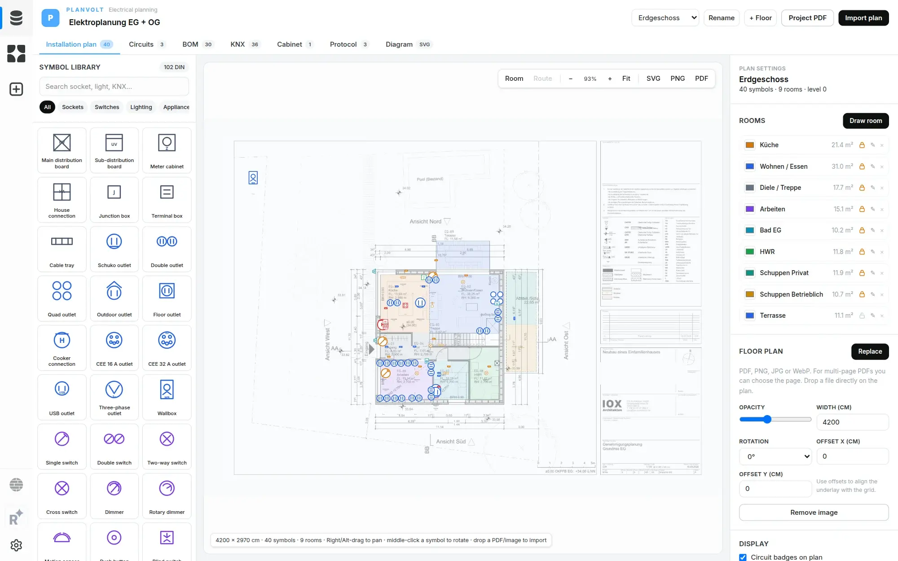
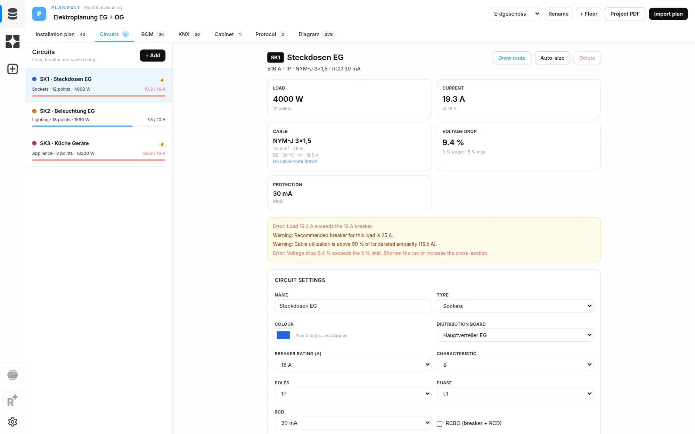
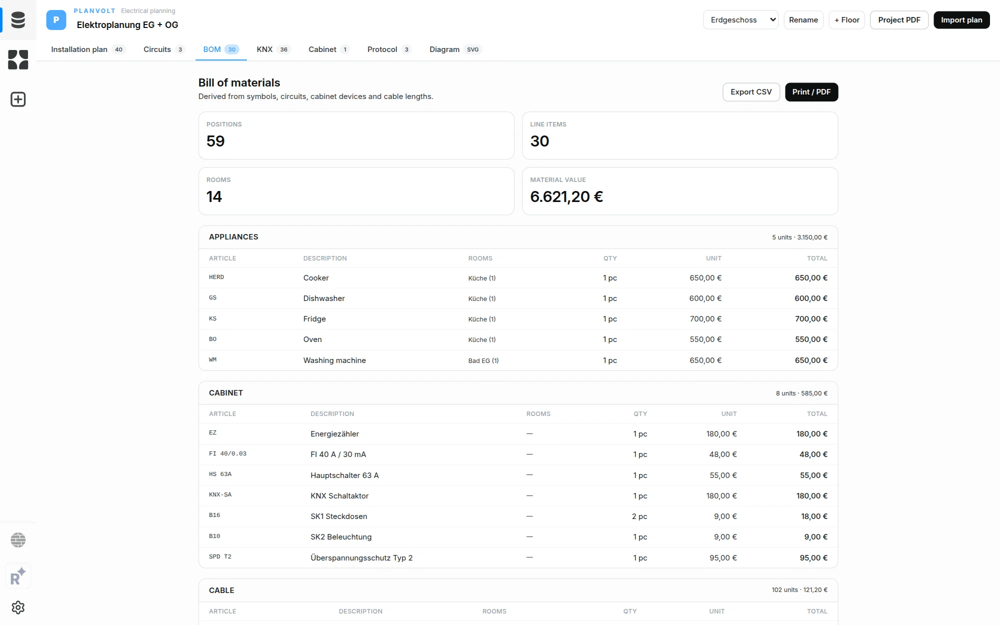
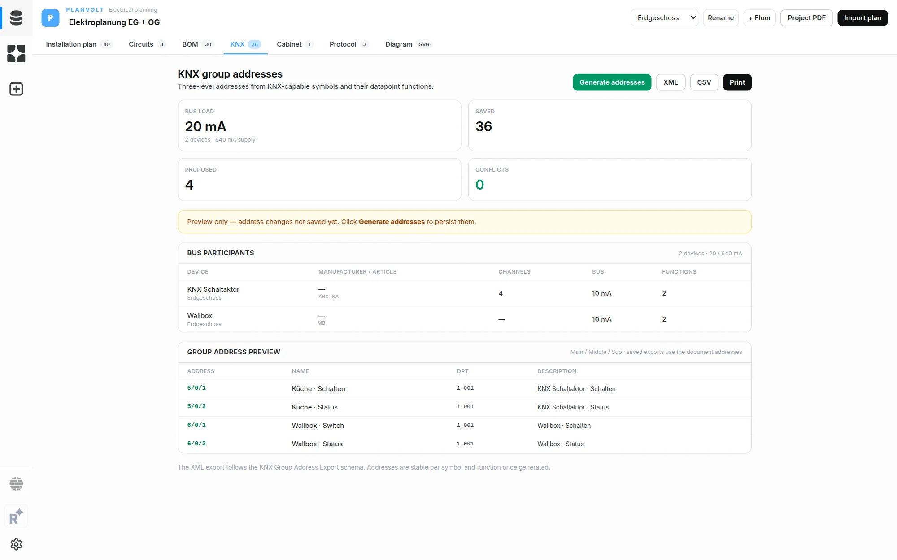
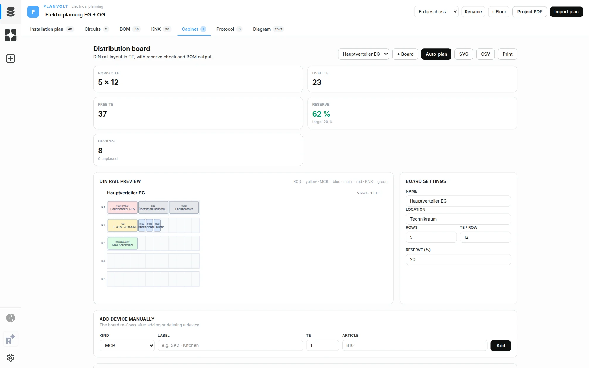
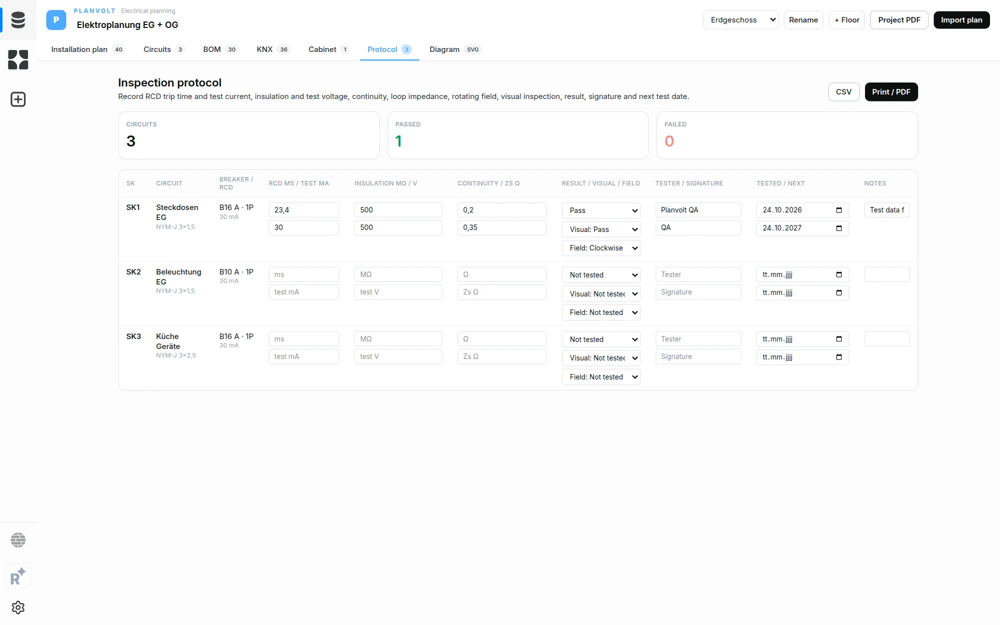
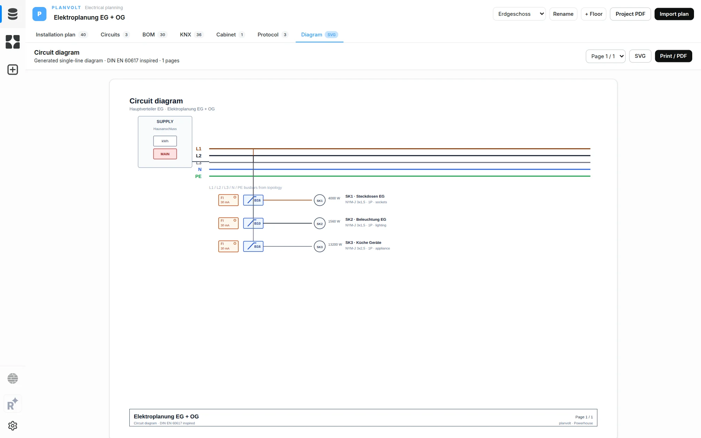

# Planvolt

Planvolt is a Powerhouse document-model package for electrical and HLSK planning. It turns a floor plan into structured trade documents: electrical installation plans with DIN 18015 / DIN EN 60617-inspired symbols, circuits, bill of materials, DIN-rail cabinet layout, KNX group addresses, an inspection protocol and an auto-generated single-line diagram; and HLSK execution plans for sanitary, heating, ventilation and climate fixtures, pipe and duct routes, risers, checks and material quantities.

The package is built as Powerhouse document models plus React editors and trade-specific drive apps, so it runs in Connect and can be consumed by reactors, processors and subgraphs the same way as other Powerhouse packages.



## Screenshots

| Circuits & cable sizing                                                                                                                                  | Bill of materials                                                                                                                    |
| -------------------------------------------------------------------------------------------------------------------------------------------------------- | ------------------------------------------------------------------------------------------------------------------------------------ |
| [](docs/screenshots/circuits.webp)                                | [](docs/screenshots/bom.webp)                |
| **KNX group addresses**                                                                                                                                  | **DIN-rail cabinet planning**                                                                                                        |
| [](docs/screenshots/knx.webp)                                         | [](docs/screenshots/cabinet.webp) |
| **Inspection protocol**                                                                                                                                  | **Generated single-line diagram**                                                                                                    |
| [](docs/screenshots/protocol.webp) | [](docs/screenshots/diagram.webp)                        |

## What is included

| Area                   | Features                                                                                                                                                                                                                                                                                                                                                                                                                             |
| ---------------------- | ------------------------------------------------------------------------------------------------------------------------------------------------------------------------------------------------------------------------------------------------------------------------------------------------------------------------------------------------------------------------------------------------------------------------------------ |
| Installation plan      | 102 DIN symbols, searchable palette, click-to-place, drag to move, rotate, lock, duplicate, delete, label, mounting height, circuit badge, cable-route polylines with automatic length, multi-floor documents, PDF/PNG/JPG/WebP underlay with page selection, opacity, lock and width calibration, drag-and-drop import, zoom controls, right-drag pan, middle-click rotate, zoom-independent and enlarged socket/switch icon glyphs |
| HLSK plan              | 22 sanitary, heating, ventilation and climate fixtures, discipline-focused tabs, click-to-place, drag to move, lock, room assignment, multi-floor documents, PDF/PNG/JPG/WebP underlay with page selection, zoom controls, right-drag pan, plan SVG/PNG export                                                                                                                                                                       |
| HLSK routes and risers | Pipe routes for waste, cold water, hot water, heating flow/return and condensate; duct routes for supply, exhaust, fresh-air intake and return air; riser markers for vertical connections; automatic route lengths and grouped material quantities                                                                                                                                                                                  |
| HLSK checks and report | Plain-language checks for missing risers, waste pipes, room assignment, pipe fall/diameter, duct airflow and heating connections, with suggested fixes; materials CSV; printable project report                                                                                                                                                                                                                                      |
| Trade drive apps       | Separate electrician and HLSK drive dashboards, trade-filtered plan lists, per-trade statistics, plan creation and one-click opening; drive `preferredEditor` metadata selects the app                                                                                                                                                                                                                                               |
| Rooms                  | Polygon drawing on the plan, automatic symbol assignment, room colours, area in m², rename/delete, draggable labels, **select and reshape rooms** (drag body or vertices, double-click an edge to add a vertex, Alt-click a vertex to remove it, Ctrl+C / Ctrl+V duplicates a room, lock/unlock prevents moving and reshaping), room schedule with points and load, room assignment in properties                                    |
| Circuits               | SK numbering, circuit kinds, colour, phase, breaker characteristic/rating/poles, RCD/RCBO, cable type/cross-section/length (manual or from route), live load aggregation, current calculation, voltage-drop estimate, overload/protection warnings, recommendation button, duplicate-number detection                                                                                                                                |
| BOM                    | Groups by category, symbol and cabinet quantities, cable lengths, room breakdown, room schedule, per-symbol price overrides and notes, material totals, CSV and print/PDF                                                                                                                                                                                                                                                            |
| KNX                    | Bus participant flag on symbols, MDT device catalogue (Glastaster II Smart with temperature sensor, switch/dimmer/blind/heating actuators), manufacturer/order number/channel metadata, line bus-load calculation with reserve warnings, stable three-level group-address generation, DPT mapping, duplicate detection, KNX XML export (Group Address Export schema) and CSV                                                         |
| Cabinet                | Distribution boards, rows × TE, auto-plan (main switch, SPD, meter, RCD banks, MCBs/RCBOs, terminal blocks, KNX actuator proposal), manual add/delete devices, reserve check, DIN-rail SVG preview, CSV and print                                                                                                                                                                                                                    |
| Protocol               | Per-circuit RCD trip time and test current, insulation resistance and test voltage, continuity, loop impedance, rotating field, visual inspection, result, tester, signature, test/next-test dates and notes; CSV and print/PDF                                                                                                                                                                                                      |
| Diagram                | Auto-generated single-line diagram grouped by distribution board, paginated, SVG per page and print/PDF                                                                                                                                                                                                                                                                                                                              |
| Exports                | Plan SVG and PNG (underlay embedded), plan print/PDF, combined project PDF (summary, plan, BOM, rooms, cabinet, diagrams, protocol), BOM CSV/print, KNX XML/CSV, cabinet SVG/CSV/print, protocol CSV/print, diagram SVG/print                                                                                                                                                                                                        |

## Architecture

```
specs/electrical-plan.json                  electrical document-model spec
specs/hlsk-plan.json                        HLSK document-model spec
document-models/electrical-plan/v1/
  gen/                                      generated GraphQL/Zod/action code
  src/reducers/                             document operations (normalisation, validation)
editors/electrical-plan-editor/
  editor.tsx                                editor shell: floors, tabs, import, keyboard
  components/                               plan canvas, palette, properties, panels
  lib/catalog.ts                            89 electrical symbols
  lib/engine.ts                             circuits, routes, BOM, KNX, cabinet, protocol, diagram
  lib/rooms.ts                              room geometry, area, hit testing
  lib/report.ts                             combined project PDF HTML
  lib/engine.test.ts                        engine tests
document-models/hlsk-plan/v1/
  gen/                                      generated GraphQL/Zod/action code
  src/reducers/                             HLSK operations (core, rooms, fixtures, pipes, ducts, risers)
editors/hlsk-plan-editor/
  editor.tsx                                HLSK editor shell: floors, trades, checks, materials, report
  components/                               plan canvas, palettes, inspector, checks and materials panels
  lib/catalog.ts                            HLSK fixture, pipe, duct and riser catalogue
  lib/engine.ts                             checks, material quantities, CSV, report helpers
  lib/geometry.ts                           room polygons, hit testing, route lengths
editors/electrician-drive-app/              electrician drive dashboard
editors/hlsk-drive-app/                     HLSK drive dashboard
editors/drive-app-shared.tsx                shared trade dashboard and plan cards
powerhouse.manifest.json                    package manifest
```

The document models own the data. Electrical UI mutations go through generated actions (`addSymbol`, `assignSymbolCircuit`, `planCabinet`, `setGroupAddresses`, `updateReport`, …); HLSK UI mutations go through the HLSK actions (`addRoom`, `addFixture`, `addPipeRoute`, `addDuctRoute`, `addRiser`, `updateSettings`, …). The host persists every action. The editors never keep a second source of truth for the plan.

Coordinates are centimetres. A background is calibrated by `widthCm`/`heightCm`. Electrical symbols store position, rotation, mount height, label, colour, lock, circuit and room assignment. HLSK fixtures store discipline, kind, position, rotation, mount height, room assignment, notes and lock; pipe and duct routes store points, type, size and slope or airflow; risers store type, position, label and notes. A unit is one floor and owns its background, rooms and trade content. Documents created before rooms existed remain readable: `rooms` is nullable in both schemas and treated as empty by the editors.

## Getting started

```bash
pnpm install
pnpm connect        # Connect at http://localhost:3000
```

Create a drive, then **Create New Document → Electrical Plan v1** or **HLSK Plan v1**. A drive opens in the generic Drive Explorer by default; set its `preferredEditor` metadata to `electrician-drive-app` or `hlsk-drive-app` to open the trade dashboard directly.

Other useful commands:

```bash
pnpm test           # Vitest
pnpm tsc            # typecheck
pnpm build          # package build
pnpm generate       # regenerate model/editor code from specs/
```

## Importing a floor plan

Use **Import plan** in the editor header and choose a PDF, PNG, JPG or WebP. For a multi-page PDF you are asked which page to use. The rendered page is stored as a JPEG data URL in the document, with a default width of 1200 cm. Adjust **Width (cm)** in the plan settings to calibrate against a known dimension. The plan image is included in plan SVG and print/PDF exports.

## HLSK execution plans

The HLSK editor covers sanitary, heating, ventilation and climate work in one document. Each floor has rooms, fixtures, pipe routes, duct routes and riser markers. Fixtures placed inside a drawn room are assigned to it automatically. The trade tabs filter the plan to sanitary, heating or ventilation work while keeping the same floor plan.

Checks are practical planning checks, not a stamped engineering design. They flag missing risers, sanitary fixtures without waste pipes, fixtures outside rooms, waste/condensate routes with too little fall, undersized pipes, ventilation duct airflow and heating fixtures without heating routes. The materials panel groups quantities by floor, category, item and size; route lengths are measured along the drawn polyline. The report panel prints the current floor plan, summary, materials and checks through the browser print dialog.

## Current boundaries

- The underlay is raster. Rooms are manually drawn polygons; there is no wall tracing, OCR or automatic room recognition.
- Cable routes are polyline runs on the installation plan; they feed length, BOM and voltage-drop calculations. Automatic routing around walls and reserved cable trays is not implemented.
- The circuit diagram is generated from circuit topology; it is not a free-form multi-page schematic editor and has no cross-reference editor yet.
- Voltage drop is a cold-cable estimate from the entered length, current and cross-section. Cable ampacity uses planning tables for installation method, ambient temperature and grouping; final selection must follow the cable manufacturer and DIN VDE 0298-4. Loop impedance is recorded in the protocol but disconnection conditions are not calculated yet.
- KNX bus load is summed per project; line topology, couplers and per-line segmentation are not modelled yet. ETS project import/export remains out of scope.
- KNX addresses are generated and exported, but ETS project import/export and participant programming are not implemented.
- BOM prices default to the built-in catalogue values; each placed symbol can override the price and carry a note.
- The combined project PDF uses the browser print dialog, not a server-side PDF renderer.
- HLSK pipe and duct routes are point polylines on the floor plan. They carry type, diameter/size, slope or airflow for quantities and checks; automatic routing around walls, fittings, hydraulic sizing and duct pressure-drop calculations are not implemented.
- HLSK risers are point markers with labels. Vertical shaft geometry, floor-to-floor alignment checks and penetration details are not modelled.
- Rooms are manually drawn polygons; wall tracing, OCR and automatic room recognition are not implemented for either document model.

## License

AGPL-3.0-only.
